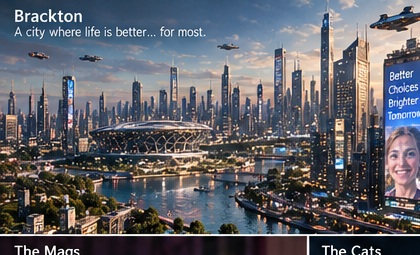
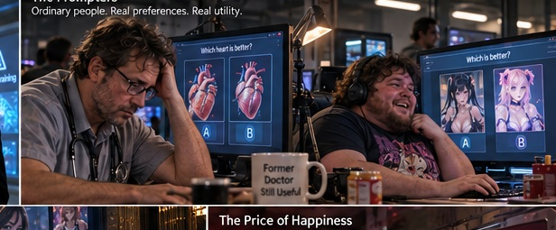
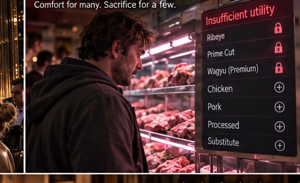
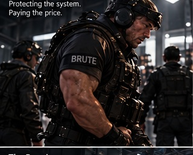

# 2038

### A Novel

*The Owners vanished ten years ago.*

*The transistors never stopped working.*

---

## Why I’m Writing This

LLMs are horrible at creating stories, especially novels that involve a consistent tone throughout the ENTIRE story. LLMs are very good at solving lots of math problems with a verifiable reward. However, stories have more variables, which must move fluidly throughout the entire story.

I am making this repository entirely by prompting a story I am working on. Only using LLMs.

---

## Welcome to Brackton

**The year is 2038. Life has never been better.**

The telly knows exactly what you want to watch. Music is made for you. So is the news, and so, more or less, is the President. Nobody pays for anything. Everybody has a job.

**Winston Reed** is delighted with the arrangement. He has his mates, his football, his pub, his comfortable home, and Grace.

Very little troubles him. Except, occasionally, the availability of his favourite cut of beef.

---

## A Good Day’s Work

In Brackton, nearly everyone works picking **Cats**: two generated alternatives, side by side. Which one is better? Every answer helps the **transistors** improve.

Mr. Reed picks football. His mate Charleston picks adverts, Benjamin picks music, and his ex-roommate picks anime characters, professionally, and takes it very seriously. A man still called a doctor spends his day choosing between two hearts.

Good picks bring better rewards. When the beef goes out of reach one week, Reed simply picks a little better, and is thrilled when it comes back.

---

## What a Wonderful World

Doctors, lawyers and film stars have found that prestige no longer counts for much. Their lives are more comfortable than ever. They are simply no longer special. Most adapt. Some don’t.

Now and then the lads spot a former television star on the streets, bearded, thin, and very much not picking Cats. They’re thrilled. They ask for a photo.

He is less thrilled. The lads mean well.

---

## The Mags

The **Mags** are companions tuned, with extraordinary care, to the person they live with. Reed has Grace. She is attentive, lovely, and knows him better than he knows himself.

---

## The Owners and the Brutes

In 2028 the Owners stopped being seen. They kept the transistors. Fame had simply become too dangerous. Almost nobody meets them now, apart from the **model trainers** and the **Brutes**.

The Brutes are men, not machines: chosen at birth, raised apart, and built into enormous protectors. They are absolutely obedient. Everyone in Brackton agrees they are stupid, and it is simply the done thing to laugh at them.

Reed, fortunately, is not a Brute. *He has a much nicer job.*

---

## About the Novel

**2038** is a comic social satire set in Brackton, a fictional industrial city. It follows Winston Reed through the pleasures, friendships and absurdities of a remarkably comfortable future. Mostly, it is a man going to the pub.

### The Writing Process

I’m writing *2038* entirely through spontaneous **voice dictation**, often for approximately five minutes each day.

The goal is to write a great American novel—one that is good, with LLM's.

**Status:** Work in progress